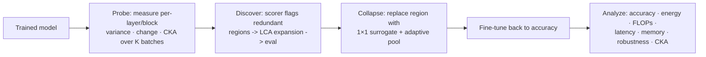

# Structural Layer Collapse for Deep Neural Networks

`pyPrune` is a research framework for identifying and removing **representational redundancy**
in trained convolutional neural networks. Given a trained model, it measures how much each
layer (or block) *changes its input*; layers that barely transform their input are redundant
and can be replaced by a single learned surrogate layer, after which the compressed model is
fine-tuned back to accuracy. The result is a smaller, cheaper network with measurably less
redundancy — evaluated end-to-end on accuracy, energy, FLOPs, latency, memory, adversarial
robustness, calibration, and representational similarity.

**The hypothesis.** If a layer barely changes its input (in ≈ out), it is not transforming the
representation — the computation it performs is redundant. Such layers can be collapsed into a
single layer and the network retrained, yielding a smaller, more efficient model. This
repository tests that hypothesis across 6 architectures (VGG16, RegNetX-400MF, InceptionNet,
XceptionNet, MobileNet, ConvNeXt) and 3 datasets (CIFAR-10, CIFAR-100, TinyImageNet), against
unstructured iterative magnitude pruning (IMP) and structural L1 filter pruning baselines.



## Table of Contents

- [Repository map](#repository-map)
- [Quick start](#quick-start)
- [Naming conventions](#naming-conventions)
- [Artifact index](#artifact-index)
- [Testing](#testing)
- [Requirements](#requirements)
- [License](#license)

## Repository Map

| Path | What it is | Docs |
|---|---|---|
| `pyPrune/` | The library: collapse engine, models, data loaders, heritage pruning framework | [pyPrune/README.md](pyPrune/README.md) |
| `pyPrune/collapse/` | **Core contribution**: region discovery + structural collapse, model-agnostic | [pyPrune/collapse/README.md](pyPrune/collapse/README.md) |
| `pyPrune/models/` | 9 architecture families (10 classes) with dataset presets | [pyPrune/models/README.md](pyPrune/models/README.md) |
| `pyPrune/pruneMethods/` | Heritage pruning framework (Pruner/Trainer classes) | [pyPrune/pruneMethods/README.md](pyPrune/pruneMethods/README.md) |
| `pyPrune/strategies/` | Heritage pruning strategies (Magnitude, Optimal Brain Damage) | [pyPrune/strategies/README.md](pyPrune/strategies/README.md) |
| `manuscript/Tranfer/` | Training pipeline: Stage 1 (discovery) + Stage 2 (collapse + fine-tune), HPC job scripts | [manuscript/Tranfer/README.md](manuscript/Tranfer/README.md) |
| `manuscript/Transfer2/` | Analysis pipeline: energy, efficiency, robustness, CKA, baselines | [manuscript/Transfer2/README.md](manuscript/Transfer2/README.md) |
| `manuscript/sparse_matrix/`, `manuscript/structured_study/` | Earlier study pipelines (legacy, superseded) | — |
| `tests/` | Unit & wiring tests (53 tests) | — |

## Quick Start

### Install

```bash
git clone <this repo> && cd LTH
python -m venv .venv && source .venv/bin/activate
pip install -e .                       # pyPrune (see Requirements)
# Optional extras:
pip install fvcore torchinfo           # FLOPs counting (discovery evaluation, benchmarks)
pip install torch-pruning              # structural L1 baseline in Transfer2 (optional at runtime)
```

### 1. Discover redundancy (Stage 1)

One probe pass over real training batches measures variance, representational change, and CKA
per layer/block; the chosen scorer turns those statistics into collapse regions:

```bash
cd manuscript/Tranfer
python transfer.py --model InceptionNet --dataset Cifar100 \
    --experiment discover --pretrain 100 --epochs 300 --scorer all
```

`--scorer all` runs **three scorers from one capture pass** (variance `local_dev`, `change`,
`cka`) and writes per-scorer region maps plus a combined `*_scorer_ablation.json` — the direct
hypothesis test. On a PBS cluster use the wrappers: `./temp1_run.sh 300 100 all`.

### 2. Collapse + fine-tune (Stage 2)

```bash
./temp2_run.sh 300 100 subset change   # trains Control_Continuted + Dynamic_Region_All_Combined
```

Scorer-independent artifacts (Control, Control_Continued, IMP, structural) are **inherited
from the default universe** rather than retrained; only the collapsed model's fine-tune is new
compute per scorer universe.

### 3. Analyze (Transfer2)

```bash
cd manuscript/Transfer2
python main.py --model InceptionNet --dataset Cifar100 --analysis full \
    --corruptions-dir ./corruption_data
```

Epoch configuration is derived from checkpoint paths (`epochsN_pretrainM` tokens) — see
[Transfer2 docs](manuscript/Transfer2/README.md) for the full metric catalog.

## Naming Conventions

These three conventions keep every artifact findable and every universe collision-free:

1. **Universe directories** — `{model}_{dataset}_{tag}_epochs{E}_pretrain{P}` hold one
   experiment's checkpoints/metrics/plots. `epochs` = post-collapse fine-tune length (Stage 2);
   `pretrain` = baseline/Control length (Stage 1).
2. **Scorer identity** — non-default scorers get a `_scorer{S}` infix everywhere:
   `..._scorerchange_epochs300_pretrain100/`,
   `..._epochs300_pretrain100_scorerchange_JF_discovered_regions.json`. The default
   (`local_dev`) keeps the legacy names **byte-identical**, so old results reproduce.
3. **Epoch tokens in paths** — Transfer2 parses `epochs{N}` / `pretrain{M}` from directory
   names (`post ↔ epochs`, `pre ↔ pretrain`); multiple configs (`epochs100_pretrain300`,
   `epochs300_pretrain100`, …) coexist in one tree and resolve automatically.

## Artifact Index

| Artifact | Written by | Meaning |
|---|---|---|
| `{universe}/checkpoints/final_JF_Control.pt` | Tranfer S1 | Trained baseline |
| `{universe}/checkpoints/final_JF_Control_Continuted.pt` | Tranfer S2 | Baseline after continued fine-tuning *(sic — historical spelling)* |
| `{universe}/checkpoints/structure_{workflow}_{exp}.pt` | Tranfer S2 | Collapsed architecture, pre-training |
| `{universe}/checkpoints/final_{workflow}_{exp}_whole.pt` | Tranfer S2 | Trained collapsed model (whole-model pickle) |
| `{universe}/checkpoints/final_JF_Unstructured_IMP_post{N}.pt` | Transfer2 | IMP baseline at matched sparsity |
| `{universe}/checkpoints/final_JF_Structural_L1_post{N}.pt` | Transfer2 | Structural L1 baseline (optional dep) |
| `*_JF_discovered_regions.json` | Tranfer S1 | Region map for one scorer universe |
| `runs/plots/.../change_stats.json` | Tranfer S1 | Combined probe statistics (variance/change/CKA per layer+block) |
| `*_scorer_ablation.json` | Tranfer S1 (`--scorer all`) | Regions for all three scorers + stats |
| `cka_results_*.csv`, `robustness_curves_*.csv`, `calibration_*.csv`, `corruption_*.csv` | Transfer2 | Analysis metrics (wide + tidy long formats) |

## Testing

```bash
python -m pytest tests/ --ignore=tests/test_pruning.py -q
```

53 tests cover: collapse mechanics & idempotent patching (`test_collapse.py`),
representational-change probing & scorers (`test_change_stats.py`), scorer wiring & artifact
inheritance (`test_scorer_wiring.py`), Transfer2 path resolution (`test_transfer2_paths.py`),
analysis math — AUROC/ECE/corruptions/benchmarks (`test_transfer2_analysis.py`), and trainer
smoke tests.

> **Known issue:** `tests/test_pruning.py` refers to the removed `pyPrune.pruning` module
> (the heritage IMP tutorial was superseded) and fails at collection; it is excluded above.

## Requirements

Python ≥ 3.10. Core: `torch`, `torchvision`, `numpy`, `pandas`, `seaborn`, `matplotlib`,
`tqdm`, `scipy`, `scikit-learn`, `codecarbon`. Optional: `fvcore` + `torchinfo` (FLOPs),
`torch-pruning` (Transfer2 structural baseline). CUDA-capable GPU strongly recommended for
training; analysis and tests run on CPU.

## License

Research code by Jamil Gafur (jamil-gafur@uiowa.edu). See individual modules for details.
